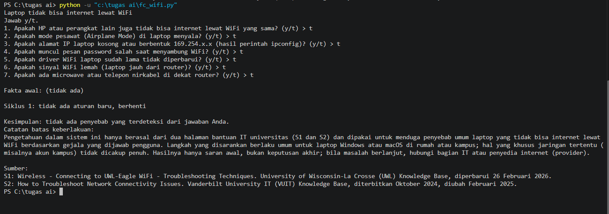

# Tugas 5 - Sistem Pakar Forward Chaining: Laptop Tidak Bisa Internet Lewat WiFi

## 1. Identitas
- Nama : **[Jihadul Muhajirin Ahmad]**
- NIM  : **[F1D02510117]**
- Mata kuliah : Kecerdasan Buatan 

## 2. Topik dan Cara Menjalankan
Topik: **gangguan WiFi pada laptop**. Program menanyakan 7 gejala (jawab `y`/`t`), lalu menyimpulkan penyebab dan langkah perbaikan beserta alasannya.

- Bahasa: Python 3.8 atau lebih baru (tanpa library tambahan)
- Perintah:
  ```
  python fc_wifi.py
  ```
  (`kb_wifi.json` harus satu folder dengan `fc_wifi.py`)

## 3. Sumber dan Tabel Aturan
Sumber (diakses 14 November 2026):

| Kode | Judul | Penerbit | URL |
|---|---|---|---|
| S1 | Wireless - Connecting to UWL-Eagle WiFi - Troubleshooting Techniques | University of Wisconsin-La Crosse (UWL) Knowledge Base, diperbarui 26 Feb 2026 | https://kb.uwlax.edu/94681 |
| S2 | How to Troubleshoot Network Connectivity Issues | Vanderbilt University IT (VUIT) Knowledge Base, diterbitkan Okt 2024 | https://tdx.vanderbilt.edu/TDClient/33/Portal/KB/Article/274/How-to-Troubleshoot-Network-Connectivity-Issues |

Aturan (disimpan di `kb_wifi.json`; "AND" = semua syarat harus ada, "OR" = salah satu cukup):

| Aturan | IF | THEN | Sumber |
|---|---|---|---|
| R1 | HP/perangkat lain juga tidak bisa internet di WiFi yang sama | masalah ada di modem/router atau provider | S2 |
| R2 | mode pesawat menyala **OR** IP laptop kosong / 169.254.x.x | laptop tidak mendapat koneksi WiFi yang valid | S1, S2 |
| R3 | masalah ada di modem/router atau provider | restart modem dan router (cabut 30 detik); bila tetap, hubungi provider | S2 |
| R4 | mode pesawat menyala | matikan mode pesawat, lalu matikan-nyalakan WiFi | S1 |
| R5 | muncul pesan password salah | hapus (forget) jaringan WiFi, sambungkan ulang dengan password benar | S1, S2 |
| R6 | laptop tidak mendapat koneksi valid **AND** driver WiFi lama tidak diperbarui | perbarui driver WiFi di Device Manager, restart laptop | S1, S2 |
| R7 | sinyal lemah (jauh dari router) **OR** ada microwave/telepon nirkabel dekat router | dekatkan laptop ke router / jauhkan router dari microwave | S2 |

Rantai antar-aturan: R1 menghasilkan "masalah di modem/router/provider" yang dipakai R3; R2 menghasilkan "laptop tidak mendapat koneksi valid" yang dipakai R6.
Kesimpulan akhir: R3, R4, R5, R6, R7. Aturan ditulis dengan kata-kata sendiri (parafrase) dari kedua sumber.

## 4. Metode: Forward Chaining
Forward chaining dipilih karena pengguna biasanya mulai dari gejala yang terlihat (mode pesawat menyala, password salah, sinyal lemah), lalu ingin tahu penyebab dan perbaikannya. Arah penalaran maju dari fakta ke kesimpulan, dan sebagian aturan bersambung (R1 -> R3, R2 -> R6).

Cara kerja program:
1. Fakta dasar (syarat yang tidak pernah menjadi hasil aturan) ditanyakan ke user dan disimpan di memori.
2. Tiap siklus: cari aturan yang syaratnya terpenuhi **dan** hasilnya belum ada di memori.
3. Ambil aturan pertama yang cocok, tambahkan hasilnya ke memori, catat alasannya.
4. Ulangi sampai tidak ada aturan baru.
5. Kesimpulan akhir = hasil yang tidak dipakai sebagai syarat aturan lain; alasannya ditelusuri mundur lewat catatan.

## 5. Kasus Uji dan Screenshot
Urutan pertanyaan: (1) perangkat lain juga tidak bisa internet, (2) mode pesawat, (3) IP kosong/169.254, (4) password salah, (5) driver lama, (6) sinyal lemah, (7) microwave/telepon nirkabel.

| # | Jawaban "ya" | Kesimpulan yang diharapkan |
|---|---|---|
| 1 | mode pesawat menyala, driver lama | matikan mode pesawat; perbarui driver |
| 2 | tidak ada | tidak ada kesimpulan (kasus negatif) |
| 3 | perangkat lain juga tidak bisa internet, sinyal lemah | restart modem/router; dekatkan laptop ke router |

''



## 6. Batas Keberlakuan
Pengetahuan dalam sistem ini hanya berasal dari dua halaman bantuan IT universitas (S1 dan S2) dan dipakai untuk menduga penyebab umum laptop yang tidak bisa internet lewat WiFi berdasarkan gejala yang dijawab pengguna. Langkah yang disarankan berlaku umum untuk laptop Windows atau macOS di rumah atau kampus; hal yang khusus jaringan tertentu (misalnya akun kampus) tidak dicakup penuh. Hasilnya hanya saran awal, bukan keputusan akhir; bila masalah berlanjut, hubungi bagian IT atau penyedia internet (provider). Paragraf ini juga ditampilkan oleh program.

## 7. Penggunaan Alat Bantu AI
Saya memakai Claude (Anthropic) untuk membantu mencari sumber, menyusun aturan, dan menulis kode serta draf README. Saya sudah membaca kedua sumber, menjalankan program, dan memahami kode serta aturannya.
